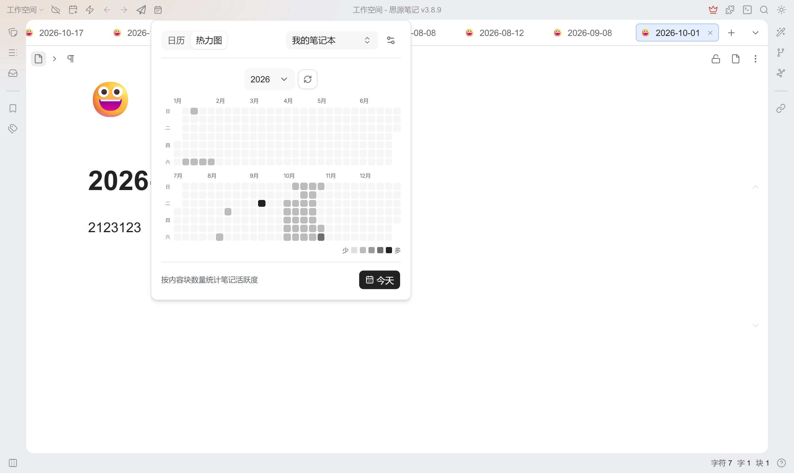

# arco-calendar

简体中文 \| [English](README_en_US.md)

思源笔记日历面板插件：在顶栏或边栏打开日历，快速新建或跳转到某一天的日记，并用年度热力图回顾日记活跃度。



## 修改颜色

插件使用 shadcn/Base UI 的 CSS 变量，可以直接在主题或代码片段中覆盖：

```css
.sy-calendar-root,
.sy-calendar-portal,
.sy-calendar-setting,
.sy-calendar-popup {
  /* 主色和主色文字 */
  --primary: #3575f0;
  --primary-foreground: #ffffff;

  /* 页面和卡片 */
  --background: var(--b3-menu-background);
  --foreground: var(--b3-theme-on-background);
  --card: var(--b3-menu-background);
  --card-foreground: var(--b3-theme-on-background);

  /* 弱化背景和文字 */
  --muted: var(--b3-list-hover);
  --muted-foreground: var(--b3-theme-on-surface);

  /* 边框、输入框和焦点 */
  --border: var(--b3-border-color);
  --input: var(--b3-border-color);
  --ring: var(--b3-theme-on-surface);

  /* 圆角 */
  --radius: 0.625rem;
}

/* 暗色模式单独覆盖 */
.sy-calendar-root.dark,
.sy-calendar-portal.dark,
.sy-calendar-setting.dark,
.sy-calendar-popup.dark {
  --primary: #8ab4ff;
  --primary-foreground: #171717;
}
```

主要使用的变量：

| 变量                                 | 作用                           |
| ------------------------------------ | ------------------------------ |
| `--primary` / `--primary-foreground` | 今天按钮、选中日期、焦点强调色 |
| `--background` / `--foreground`      | 面板底色和正文颜色             |
| `--card` / `--card-foreground`       | 面板卡片颜色                   |
| `--muted` / `--muted-foreground`     | 周数、提示文字和弱化背景       |
| `--border` / `--input`               | 分隔线、边框和输入控件         |
| `--ring`                             | 键盘焦点环                     |
| `--radius`                           | 面板和控件的圆角               |

## 功能

- 顶栏左侧、顶栏右侧或边栏 Dock 三种入口位置
- 月历上标记已经存在的日记，点击任意日期即可打开或创建日记
- 已有日记的日期使用柔和圆底标记，缺失日记的日期保持空白；日记内存在未完成任务时显示琥珀色角标，可在设置中关闭
- 顶部月份/年份下拉选择，右侧提供刷新入口
- 日历面板右上角提供设置入口：
  - 每周从星期一开始或从星期日开始
  - 在日历左侧显示周数
- 月份/年份选择器右侧提供刷新图标，可手动同步笔记本和日记映射，并提示刷新成功或失败
- 顶部“日历 / 热力图”切换，年度热力图按笔记内容块数量显示活跃度：日记内容块归入日记日期，其他笔记按内容块创建日期统计，并按上下半年拆成两段以控制宽度
- 热力图按周排列，支持周起始日设置，并可用年份选择器查看不同年份；悬停色块可查看当天内容块数量，点击色块可打开或创建当天日记，面板左下角显示全年内容块总数
- 笔记本选择器支持搜索，选择结果会同步到思源的 `local-dailynoteid`
- 跟随思源主题自动切换明暗配色，支持桌面端、移动端和浏览器端

## 技术栈

- **React 19** + TypeScript
- **shadcn/ui**（Card、Button、Separator、Select、Popover、Command、Calendar）与 Base UI 无障碍原语
- **shadcn/ui Vega 预设**：中性色主题、Inter 字体、Vega 组件的圆角与间距风格
- **Tailwind CSS 4**，只输出插件用到的样式，并将 `shadcn` 设计变量映射到思源主题变量
- **Vite 8** 库模式打包，React 组件会随插件一起打包，不依赖宿主的全局 React

## 插件架构

```text
src/
├── index.tsx                 # SiYuan Plugin 生命周期：onload / onLayoutReady / onunload
├── api/                      # 类型化内核 API 与笔记本/日记查询
├── components/
│   ├── ui/                   # shadcn/ui 组件源码
│   ├── calendar-app.tsx      # React 根组件（注入宿主上下文）
│   ├── calendar-panel.tsx    # 卡片布局、头部、视图切换与刷新/设置入口
│   ├── calendar-view.tsx     # 月历、月份/年份选择与日标记
│   ├── heatmap-view.tsx      # 年度热力图、年份选择与图例
│   ├── panel-view-switch.tsx # 日历/热力图切换
│   ├── notebook-combobox.tsx # 可搜索的笔记本选择器
│   └── position-select.tsx   # 入口位置选择
├── hooks/                    # useNotebooks / useDailyNotes / useNoteActivity / useLocale / useIsDark
├── lib/                      # 纯函数、宿主 Context、i18n、存储、图标
├── types/                    # 领域类型与 i18n 类型
└── ...
```

- React 通过 `createRoot` 挂载到顶栏弹层或 Dock 元素，关闭弹层、关闭 Dock、卸载插件时都会调用 `root.unmount()`，避免事件监听泄漏。
- 事件总线监听统一在 React effect 的清理函数中注销；`ws-main` 的笔记本和日记变更会增量刷新界面。
- 设置在日历面板的 Popover 中即时生效并保存，不再依赖整页刷新。

## 数据加载时序

1. `onload` 读取 `arco-calendar-entry` 设置并注册图标；`onLayoutReady` 挂载顶栏或 Dock。
2. `useNotebooks` 并行获取笔记本列表与 `local-dailynoteid`，构建轻量笔记本对象。
3. 笔记本确定后，`useDailyNotes` 用 SQL 查询当前月及前后月的日记属性，并补充未完成任务状态。
4. 切换到热力图时，`useNoteActivity` 按年统计：日记内容块归入日记日期，其他笔记按内容块创建日期汇总，用于计算颜色强度。
5. `useLocale` 在插件会话内缓存 date-fns locale，多个组件共享。
6. 点击日期时优先命中已有日记映射，否则调用内核的 `createDailyNote`（带 `date` 参数）创建日记；父目录、模板、图标和 `custom-dailynote-*` 属性由内核原子处理，随后更新映射。
7. `ws-main` 的 `createnotebook` / `mount` / `unmount` 触发笔记本刷新，`removeDoc` / `createdailynote` 触发日记映射刷新。
8. `useNotebooks` 和 `useDailyNotes` 都使用请求序号丢弃过期响应；主题监听由一个共享存储统一管理。

`src/components/ui` 下的组件来自 shadcn/ui `base-vega` 仓库分发版本。插件特有的行为（已有日记圆底、任务角标、portal 层级、插件图标）放在业务组件或原语组合中，不直接修改这些分发文件。

## 开发

要求 Node.js >= 24、pnpm 12。

```bash
pnpm install
pnpm type-check
pnpm test
pnpm build
```

`pnpm build` 会依次执行清单校验、类型检查、生产构建，并在根目录生成 `package.zip`。

开发调试（`pnpm dev` 会持续监听，请在另一个终端执行 `make-link`）：

```bash
pnpm dev         # 监听构建到 dev/
pnpm make-link   # 将 dev/ 链接到思源工作空间的插件目录
```

Windows 上创建目录符号链接需要权限；如果没有权限，`pnpm make-link` 会自动弹出 UAC，仅对创建链接这一步请求管理员权限：

```bash
pnpm make-link      # Linux / macOS / Windows（Windows 无权限时会自动请求 UAC）
pnpm make-install   # 所有平台：构建后把 dist/ 复制到插件目录（无热更新）
```

如果取消 UAC，也可以使用 `pnpm make-install`。

所有开发脚本以 Node.js 实现；Windows 的自动提权步骤会调用系统 PowerShell。

也可以在终端中设置 `SIYUAN_PLUGIN_DIR` 指向 `<工作空间>/data/plugins`，跳过自动查找工作空间。
`pnpm make-install` 会覆盖同名插件目录；安装后在思源中重新启用插件即可。

## 发布

发布流程使用 [semantic-release](https://github.com/semantic-release/semantic-release)，全自动完成：

1. 合并到 `main`（直接 push 或合并 PR）后，按 Conventional Commits 计算版本
2. 自动更新 `package.json`、`public/plugin.json` 与 `CHANGELOG.md`
3. 自动打 `vX.Y.Z` tag，执行 `pnpm check` 与生产构建
4. 创建 GitHub Release 并上传 `package.zip`

无需手动改版本或创建 Release PR。提交信息需遵循 Conventional Commits（`feat:` / `fix:` / `chore:`…）。

## 版本日志

[Changelog](./CHANGELOG.md)

## 参考与感谢

- [BryceAndJuly](https://github.com/BryceAndJuly) 在社区中的[首次实现](https://ld246.com/article/1662969146166)
- [HowcanoeWang/calendar](https://github.com/HowcanoeWang/calendar) 对上一项目的反编译以及功能拓展
- [九炎](https://github.com/leolee9086) 大佬提供的 WebSocket 封装模板

## License

[License](./LICENSE)
