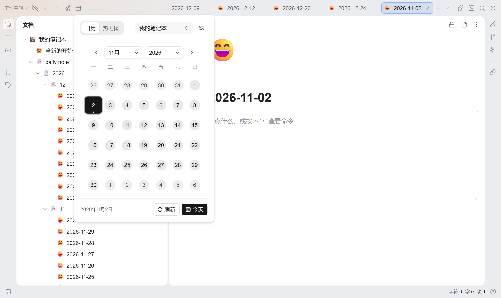

# arco-calendar

[简体中文](README.md) \| English

A calendar panel plugin for SiYuan Note. Open a calendar from the top bar or dock, quickly create or jump to a daily note, and review writing activity in a yearly heatmap.



## Features

- Three entry positions: top-left, top-right, or dock
- Existing daily notes are highlighted on the month calendar; click any date to open or create it
- Existing notes use a soft accent-tinted disc; days without a note stay plain, and notes with unfinished tasks show an amber corner dot
- Today carries a small dot under the date, which switches to the contrast colour once selected so it never blends into the chip
- Month/year dropdowns with a refresh action, plus a settings entry in the panel header
- Settings: entry position, week start, week numbers, unfinished-task markers, and use-theme-color
- "Use theme color" switches the selected date, buttons, note disc and heatmap to the SiYuan accent; with it off the Vega neutral palette is used
- Calendar / Heatmap switch; the yearly heatmap counts content blocks across all notes, attributing daily-note blocks to the diary date and other blocks to their creation date
- Heatmap weeks follow the configured week start, with a year selector; hovering a cell shows that day's block count, clicking opens or creates that day's daily note, and the footer shows the yearly total
- Searchable notebook selector, synchronized with SiYuan's `local-dailynoteid`
- Automatically follows the active SiYuan theme; works on desktop, mobile, and browser frontends

## Install

Install "Calendar Panel" from the SiYuan marketplace, or download `package.zip` from [Releases](https://github.com/svchord/siyuan-arco-calendar/releases), extract it into `<workspace>/data/plugins/`, and enable it in SiYuan.

Requires SiYuan 3.8.5 or newer.

## Modifying Colors

The plugin uses shadcn/Base UI CSS variables, which can be overridden in a theme or code snippet:

```css
.sy-calendar-root,
.sy-calendar-portal,
.sy-calendar-setting,
.sy-calendar-popup {
  /* Primary accent and its foreground */
  --primary: #3575f0;
  --primary-foreground: #ffffff;

  /* Page and card colors */
  --background: var(--b3-menu-background);
  --foreground: var(--b3-theme-on-background);
  --card: var(--b3-menu-background);
  --card-foreground: var(--b3-theme-on-background);

  /* Muted surfaces and text */
  --muted: var(--b3-list-hover);
  --muted-foreground: var(--b3-theme-on-surface);

  /* Borders, inputs, focus */
  --border: var(--b3-border-color);
  --input: var(--b3-border-color);
  --ring: var(--b3-theme-on-surface);

  /* Radius */
  --radius: 0.625rem;
}

/* Dark-mode overrides */
.sy-calendar-root.dark,
.sy-calendar-portal.dark,
.sy-calendar-setting.dark,
.sy-calendar-popup.dark {
  --primary: #8ab4ff;
  --primary-foreground: #171717;
}
```

By default `--primary` falls back to the Vega neutral palette. With the "use theme color" setting enabled, the plugin publishes `--arco-calendar-accent` / `--arco-calendar-accent-foreground` on `<html>` and those take over `--primary`, so emphasis surfaces follow the SiYuan accent. Override the two variables above to pin a fixed palette instead.

Main variables:

| Variable                             | Purpose                                   |
| ------------------------------------ | ----------------------------------------- |
| `--primary` / `--primary-foreground` | Today button, selected date, accent color |
| `--background` / `--foreground`      | Panel background and body text            |
| `--card` / `--card-foreground`       | Panel card colors                         |
| `--muted` / `--muted-foreground`     | Week numbers, hints, and muted surfaces   |
| `--border` / `--input`               | Dividers, borders, and input controls     |
| `--ring`                             | Keyboard focus ring                       |
| `--radius`                           | Panel and control radius                  |

## Development

Requires Node.js >= 24.15 and pnpm 12.

```bash
pnpm install
pnpm dev     # watch-build, linked into the SiYuan plugin directory with hot refresh
pnpm check   # format + lint + types + tests
pnpm build   # production build, produces package.zip
```

Linking the plugin directory needs administrator rights on Windows; the build requests UAC once when they are missing and aborts with an error if refused.
Set `SIYUAN_PLUGIN_DIR` to `<workspace>/data/plugins` to skip workspace discovery.

Verify style and interaction changes in a real SiYuan window. Components under `src/components/ui` come from the shadcn/ui `base-vega` distribution; plugin-specific behavior lives in app components rather than edits to those files.

## Release

Releases are versioned by [release-please](https://github.com/googleapis/release-please); the version is never bumped by hand:

```
a normal PR lands on main
  └─ release-please opens/updates a Release PR "chore(main): release x.y.z"
       └─ merge that PR
            └─ tag, GitHub Release and CHANGELOG.md are generated
                 └─ package.zip is built and uploaded
```

PR titles must follow Conventional Commits (`feat:` / `fix:` / `chore:`…); CI checks them, and merges are always **Squash and merge**.
The `version` in `package.json` and `public/plugin.json` is maintained by the Release PR — do not edit it by hand.

Local commits are checked too: `pnpm install` installs husky hooks via `prepare`, `commit-msg` lints a single
message and `pre-push` lints the commits a push adds, both against `commitlint.config.js`. Commits made with
`git commit --no-verify` are rejected at push time; if you really need to skip it, use `git push --no-verify`
and confirm the commit never reaches the CHANGELOG.

## Changelog

[Changelog](./CHANGELOG.md)

## Reference and Thanks

- [BryceAndJuly](https://github.com/BryceAndJuly) for the [first community implementation](https://ld246.com/article/1662969146166)
- [HowcanoeWang/calendar](https://github.com/HowcanoeWang/calendar) for decompilation and feature work on the previous project
- [Jiuyan](https://github.com/leolee9086) for the WebSocket wrapper template

## License

[License](./LICENSE)
